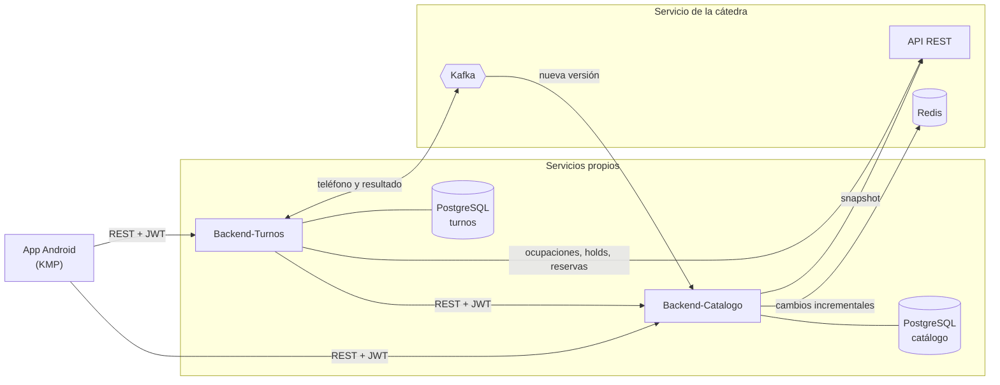

# Documentacion

Documentación transversal del proyecto integrador de Programación 2 (Universidad de Mendoza, 2026): una aplicación Android para consultar profesionales y reservar turnos, con dos servicios backend propios integrados al servicio central de la cátedra.

## Repositorios

| Repositorio | Qué contiene |
|---|---|
| [Backend-Catalogo](https://github.com/prog-2-SQR/Backend-Catalogo) | Servicio de catálogo y sincronización (Java 25, Spring Boot 4.1) |
| [Backend-Turnos](https://github.com/prog-2-SQR/Backend-Turnos) | Servicio de usuarios, disponibilidad y reservas (Java 25, Spring Boot 4.1) |
| [Frontend-KMP](https://github.com/prog-2-SQR/Frontend-KMP) | Aplicación Android con Kotlin Multiplatform y Compose |
| [Documentacion](https://github.com/prog-2-SQR/Documentacion) | Este repositorio: visión de conjunto, casos de uso, diagramas y contratos |

Cada repositorio de código tiene su propio `README` con cómo ejecutarlo y su carpeta `docs/` con las decisiones de arquitectura (ADR) y la especificación del servicio.

## Arquitectura general

- Cada servicio es dueño exclusivo de su base de datos. No hay tablas compartidas (enunciado §3).
- La app nunca habla con la cátedra: todo pasa por los dos backends.
- Turnos consulta a Catálogo por contrato REST protegido con JWT. No guarda una réplica del catálogo.

## Índice de documentación

Mapa de la documentación obligatoria (enunciado §12) y dónde se encuentra cada parte.

| Documento | Ubicación | Estado |
|---|---|---|
| README con pasos reproducibles | `README.md` de cada repositorio | En progreso |
| Diagrama de arquitectura | Este README | Inicial |
| Casos de uso por servicio | [`casos-de-uso/`](casos-de-uso/README.md) | Inicial |
| Diagramas de secuencia (sincronización y reserva) | [`diagramas/sincronizacion.md`](diagramas/sincronizacion.md), [`diagramas/reserva.md`](diagramas/reserva.md) | Inicial |
| Contratos entre servicios (operaciones, DTO, autenticación, errores) | `contratos/` | Pendiente (M4) |
| Modelo de datos y propiedad de cada servicio | `diagramas/` | Pendiente |
| Estrategia de sincronización completa e incremental | [`diagramas/sincronizacion.md`](diagramas/sincronizacion.md) | Inicial |
| Idempotencia y recuperación ante mensajes duplicados, perdidos o fuera de orden | [`diagramas/`](diagramas/sincronizacion.md) (reglas de cada diagrama) | Inicial |
| Decisiones de seguridad, autenticación y autorización | `docs/adr/` de cada servicio | Pendiente (M5) |
| Cómo ejecutar las pruebas automatizadas | `README.md` de cada servicio | En progreso |
| Compose unificado para levantar toda la solución | `compose.yaml` en este repositorio | Pendiente (M9) |

## Referencias

- Enunciado del proyecto (`PROJECT_STATEMENT-v1`) y anexo técnico de integración (`INTEGRATION_REFERENCE-v2`), entregados por la cátedra. El anexo es la fuente de verdad para los contratos REST, Redis y Kafka.
- Arquitectura hexagonal con vertical slicing según el modelo del profesor: [dqmdz/hexagonal](https://github.com/dqmdz/hexagonal).
