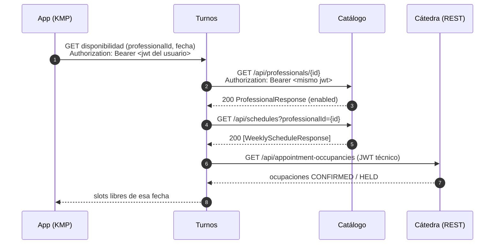

# Contrato entre servicios: Turnos → Catálogo

Qué consulta el servicio de turnos al servicio de catálogo, con qué autenticación, qué recibe y qué hace ante cada error (enunciado §12).

Turnos **no guarda una réplica del catálogo**: antes de iniciar una operación pide la información vigente (enunciado §4.2). Puede guardar en una reserva datos descriptivos históricos del profesional (nombre), pero nunca usarlos como catálogo vigente.

## Para qué lo usa Turnos

| Caso de uso de Turnos | Qué necesita del catálogo | Operación |
|---|---|---|
| Consultar disponibilidad (CU-TUR-03) | Que el profesional exista y esté habilitado, y sus horarios semanales vigentes | `GET /api/professionals/{id}` y `GET /api/schedules?professionalId={id}` |
| Iniciar reserva / crear hold (CU-TUR-04) | Revalidar profesional y horario justo antes de pedir el hold a la cátedra | las mismas |

Los slots libres de una fecha los calcula Turnos: combina estas reglas semanales con las ocupaciones de la cátedra (enunciado §7, anexo §8).



## Autenticación

- Todas las operaciones del catálogo requieren `Authorization: Bearer <jwt>` (Backend-Catalogo #27).
- **Turnos reenvía el JWT del usuario** que hizo el pedido (*token relay*). Ese token lo emitió el propio Turnos al iniciar sesión (HS512, claims `sub` y `auth`), y el catálogo lo valida con el **secreto compartido** `JWT_BASE64_SECRET`: el mismo valor configurado en los dos servicios (modelo JHipster).
- El **JWT técnico de la cátedra nunca se envía al catálogo** ni sale de Turnos hacia la app (anexo §2).
- Si en el futuro hiciera falta llamar al catálogo sin un usuario (por ejemplo, una tarea programada), Turnos puede firmar un token de servicio con el mismo secreto y un rol propio. Hoy no hay ningún caso así.

## Operaciones

Base: `CATALOGO_URL` (por ejemplo `http://localhost:8080`). Respuestas en `application/json`; errores en `application/problem+json`.

### `GET /api/professionals/{id}`

Respuesta `200`:

```json
{
  "id": 201,
  "categoryId": 101,
  "firstName": "Ana",
  "lastName": "Torres",
  "enabled": true
}
```

| Campo | Tipo | Notas |
|---|---|---|
| `id` | long | ID de la cátedra |
| `categoryId` | long | referencia por ID a la categoría (ADR 0003 del catálogo) |
| `firstName`, `lastName` | string | |
| `enabled` | boolean | `false` = baja lógica: no se pueden iniciar reservas |

### `GET /api/schedules?professionalId={id}`

Respuesta `200` (lista, puede ser vacía):

```json
[
  {
    "id": 301,
    "professionalId": 201,
    "dayOfWeek": "MONDAY",
    "startTime": "12:00:00",
    "endTime": "15:00:00",
    "slotDurationMinutes": 30,
    "enabled": true
  }
]
```

| Campo | Tipo | Notas |
|---|---|---|
| `dayOfWeek` | `MONDAY` … `SUNDAY` | anexo §7 |
| `startTime`, `endTime` | `HH:mm:ss` | horas **locales de atención** (anexo §4); Turnos acepta también `HH:mm` |
| `slotDurationMinutes` | int | duración de cada turno dentro de la franja |
| `enabled` | boolean | solo los horarios habilitados generan disponibilidad |

### Otras operaciones disponibles

Las usa la app; Turnos no las necesita hoy.

| Operación | Descripción |
|---|---|
| `GET /api/categories`, `GET /api/categories/{id}` | Categorías |
| `GET /api/professionals/search?categoryId=&name=&enabled=&dayOfWeek=&page=&size=` | Búsqueda paginada (`page` desde 0, `size` 1–100, por defecto 20) → `{content, page, size, totalElements, totalPages}` |
| `GET /api/schedules/{id}` | Un horario |

## Errores y qué hace Turnos

| Respuesta del catálogo | `code` | Qué significa | Qué hace Turnos |
|---|---|---|---|
| `401` | (puede no tener `code`) | token ausente, vencido o inválido | responde `401` a la app (la sesión venció) |
| `404` | `PROFESSIONAL_NOT_FOUND` | el profesional no existe en la copia local | responde `404 PROFESSIONAL_NOT_FOUND` (mismo code que la cátedra, anexo §13.1) |
| `200` con `enabled: false` | — | profesional deshabilitado | responde `400 PROFESSIONAL_DISABLED` y no pide el hold |
| `400` | `VALIDATION_ERROR` | parámetro inválido | error de programación de Turnos: se registra y responde `500` |
| `5xx`, timeout o sin conexión | — | catálogo no disponible | responde `503 CATALOG_UNAVAILABLE` y **no inicia** la operación (enunciado §8) |

- **Timeouts:** conexión 2 s, lectura 5 s.
- **Reintentos:** las consultas son lecturas (`GET`), así que se pueden repetir sin efectos: hasta 2 reintentos con espera creciente, solo ante timeout o `5xx`. Un `4xx` no se reintenta.
- Turnos decide por `status` y `code`, nunca por el texto de `detail` (anexo §13).

## Referencias

- Enunciado §4.2, §7, §8, §12; anexo §2, §4, §7, §8, §13.
- Backend-Catalogo: #27 (seguridad), #29 y #31 (búsqueda), ADR 0003.
- Backend-Turnos: #11 (login y JWT).
