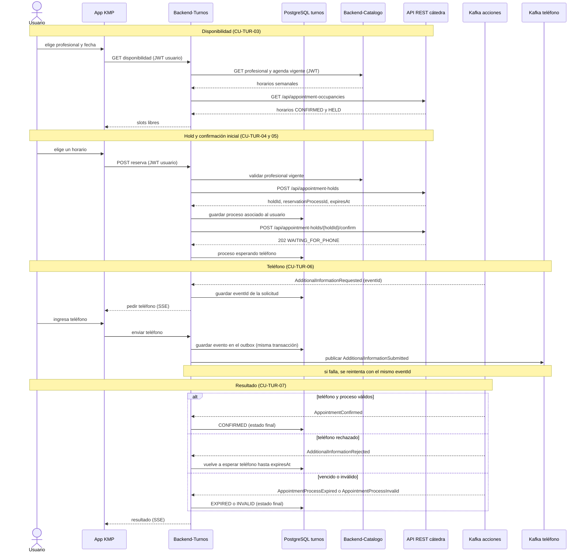

# Reserva de un turno

Proceso completo desde que el usuario elige un horario hasta el resultado final. Cubre CU-TUR-03 a CU-TUR-07.

Identidades: la app habla con Backend-Turnos usando el **JWT del usuario**; Turnos habla con la cátedra usando el **JWT técnico**, que nunca llega a la app. Turnos asocia cada proceso al usuario que lo inició, porque la cátedra no conoce a los usuarios finales (anexo §2).

## Secuencia

## Reglas

| Situación | Qué hace el servicio | Referencia |
|---|---|---|
| Mensaje Kafka repetido (mismo `eventId`) | Lo reconoce como procesado, no repite efectos y confirma el offset | Anexo §18.1 |
| Evento que llega tarde sobre un proceso ya finalizado | Lo ignora: un estado final nunca retrocede | Enunciado §7 |
| Kafka no confirma la publicación del teléfono | El outbox reintenta con el **mismo** `eventId`; la cátedra ignora duplicados | Decisión confirmada por el profesor en Slack |
| Kafka confirma la recepción | No significa reserva confirmada: eso solo lo dice `AppointmentConfirmed` | Decisión confirmada por el profesor en Slack |
| Timeout en una llamada REST con efectos | Antes de repetirla, consulta el estado con los IDs guardados | Anexo §18.4 |
| Hold vencido (`HOLD_EXPIRED` o `AppointmentProcessExpired`) | Cierra el proceso como vencido y no vuelve a intentar confirmarlo | Anexo §18.3 |
| Catálogo no disponible | No inicia la reserva: no puede validar la información vigente | Enunciado §8 |

Los nombres de los estados locales son tentativos: la máquina de estados se define en M6.
