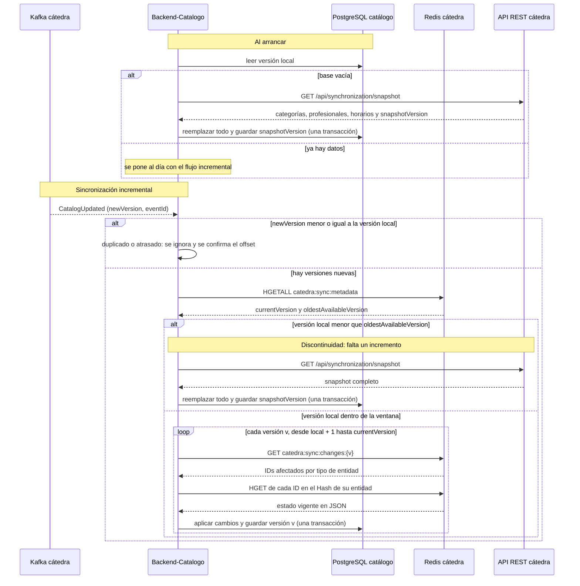

# Sincronización del catálogo

Cómo Backend-Catalogo mantiene su copia local alineada con el catálogo publicado por la cátedra. Cubre CU-CAT-01, CU-CAT-02 y CU-CAT-03.

Las piezas de la cátedra que intervienen:

- **Kafka** (`catedra.catalog.{groupId}`) solo **avisa** que hay una versión nueva (`CatalogUpdated`).
- **Redis** tiene la metadata de versiones, los IDs que cambiaron en cada versión y el estado vigente de cada entidad.
- **REST** entrega el snapshot completo cuando hay que reconstruir.

## Secuencia

## Reglas

| Situación | Qué hace el servicio | Por qué |
|---|---|---|
| Base vacía | Snapshot completo | Enunciado §6.1 |
| Notificación duplicada o vieja | La ignora | `newVersion` no supera la versión local; procesarla de nuevo no cambia nada (§6.2) |
| Notificación perdida | No hace falta recuperarla | La siguiente notificación recorre **todas** las versiones desde `local + 1` hasta `currentVersion` |
| Versión local menor que `oldestAvailableVersion` | Snapshot completo | Redis ya no tiene el incremento que conecta el estado local con los siguientes (anexo §18.2) |
| Falta `changes:{v}` en Redis o el JSON no es válido | Snapshot completo | El estado local no puede verificarse (§6.2) |
| Falla a mitad de una versión | Rollback de esa versión | La versión local avanza solo si **todos** sus cambios quedaron aplicados (anexo §14.5). Se reintenta con la próxima notificación |
| La cátedra no responde | Se conserva la copia actual | Las búsquedas siguen funcionando con los datos locales; el error queda en el estado de sincronización (CU-CAT-06) |

**Unidad de trabajo:** cada versión se aplica en una transacción propia. Así el catálogo local siempre corresponde exactamente a la versión guardada, nunca a una mezcla.
